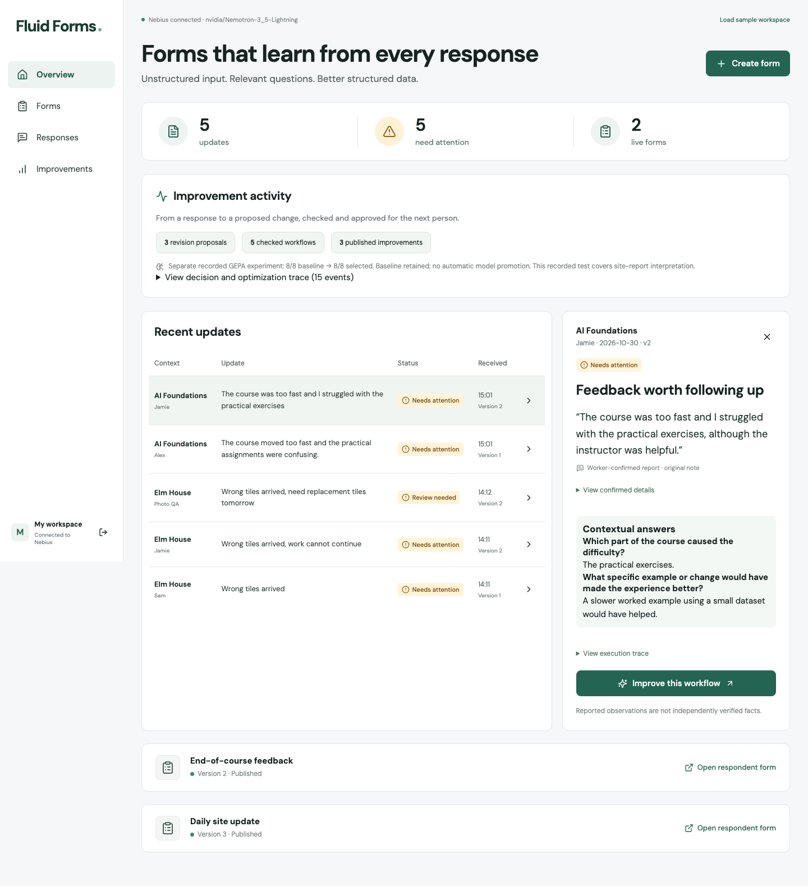

# Fieldnote

Adaptive site updates for small contractors. Create a workflow, collect a worker’s report, see what’s missing, and publish an evaluated improvement for the next visit.

Built for the [Nebius × NVIDIA Global AI Hackathon](https://nebiusglobalaihackathon.devpost.com/).

**[Live demo](https://fluid-forms.exe.xyz/)** — owner access token is supplied privately in the judging/testing instructions.



[Review walkthrough and recorded results](docs/REVIEW_GUIDE.md) · [C4 architecture diagrams](docs/ARCHITECTURE.md) · [Deployment](docs/DEPLOYMENT.md) · [MIT license](LICENSE)

## What works

- Template-based creation, preview, checks, and explicit publication.
- Voice/text updates, editable interpretation, conditional questions, and photo evidence.
- Response summaries with original notes, evidence exceptions, and office review.
- Feedback-driven revisions, immutable versions, pinned sessions, and rollback.
- Separate contract regression checks and a runnable offline DSPy/GEPA experiment.

## Run locally

Requires Python 3.12, [uv](https://docs.astral.sh/uv/), and Node.js 22+.

```bash
uv sync --python 3.12
npm --prefix web ci
cp .env.example .env
./scripts/dev.sh
```

Open **http://127.0.0.1:5173**. Choose **Load sample workspace** to explore labeled examples, or **Create form** to start fresh. Data persists under `.data/`.

For a single-server build:

```bash
npm --prefix web run build
.venv/bin/python scripts/serve.py
```

Open **http://127.0.0.1:8000**. Stop the development API first if it already uses that port.

## Connect AI

Set `NEBIUS_API_KEY` in `.env`, then restart the server. Verified model IDs: `nvidia/Nemotron-3_5-Lightning` for generation, interpretation, and revision proposals; `nvidia/Nemotron-3.5-Super-VL` for advisory delivery-photo checks. Both run through Nebius Token Factory. Optional `VISION_BASE_URL` and `VISION_API_KEY` override the Nebius connection.

Without credentials, the app clearly labels **local demo mode**: curated templates and deterministic interpretation rules. Provider failures never silently fall back to demo results. Without vision access, photos are retained for human review. Browser voice recognition depends on browser support and permission; it is not NVIDIA transcription.

## Verify

```bash
.venv/bin/python -m pytest -q
npm --prefix web run build
# Requires live Nebius access; incurs inference usage, never auto-publishes:
.venv/bin/python -m evals.optimize --max-metric-calls 18 --max-seconds 600
```

The experiment compares baseline and GEPA-selected program on separate synthetic held-out examples. Its report appears under **Improvements**; a recorded report is included for review without spending credits. Final smoke result: 8/8 for both, with the baseline retained. This is not a production reliability or optimization-gain claim. A failed or unimproved candidate does not replace the runtime program. Each experiment has a 56-request hard cap; it is optional for trying the product.

## Architecture and limits

**[Explore three C4 layers: system context → containers → backend components](docs/ARCHITECTURE.md)**, including the exe.dev boundary, persistent storage, NVIDIA/Nebius model roles, and the separate offline GEPA harness.

React/Vite + Vercel json-render; FastAPI + SQLAlchemy; DSPy + GEPA. SQLite is the default. `DATABASE_URL` can target PostgreSQL/Neon; that deployment path has not yet been tested. Form revisions are versioned data, not database schema migrations.

This is a single-workspace prototype. Set `OWNER_TOKEN` before external exposure; worker links/session IDs act as bearer access. Photos require office review, model thresholds are not calibrated, and live model/voice/device testing depends on configured services. No WhatsApp integration, browser model training, or arbitrary generated-code execution.

## Project notes

- [Demo journey](docs/DEMO_USER_JOURNEY.md)
- [Current build decisions](docs/BUILD_DECISIONS.md)
- [Technical decisions and evaluation plan](docs/TECHNICAL_DECISIONS.md)
- [Full product vision](docs/PRD.md)
- [Hackathon rules and resources](docs/HACKATHON_OVERVIEW.md)

Verified: 11 backend tests, production build, desktop/mobile HTTPS browser journey, live NVIDIA text/vision calls, and database/photo persistence after a service restart. Submission video URL is pending.
