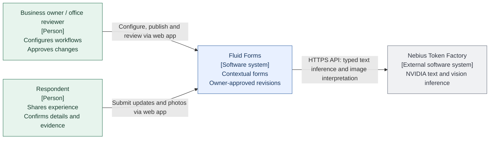
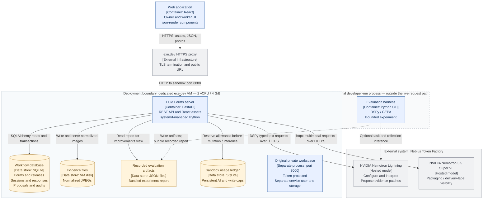
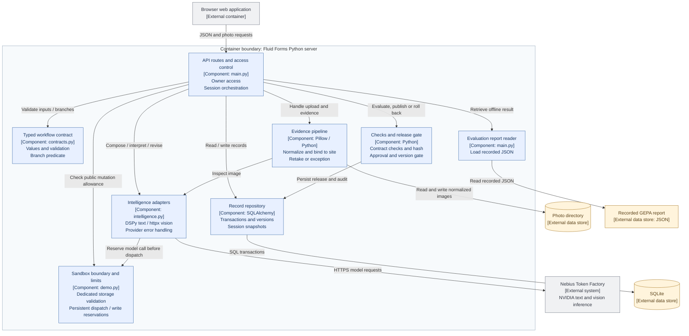

# Application architecture — C4 views

These three views describe the working Fluid Forms application deployed at [fluid-forms.exe.xyz](https://fluid-forms.exe.xyz/). They follow the [C4 model's](https://c4model.com/diagrams) context → container → component levels, using Mermaid flowcharts that render directly on GitHub. A **container** here means an application or data store, not necessarily a Docker container.

Blue nodes are Fluid Forms software, grey nodes are external systems, green nodes are people, and amber nodes are persistent data. Dashed arrows show optional offline evaluation and its recorded artifacts; solid arrows show the live application path.

## Level 1 — System context

**Who uses Fluid Forms, and which external service powers its intelligence?**

The owner and respondent use the same web application with different views. The private workspace requires an owner access token. The public URL opens a separately deployed anonymous sandbox where visitors share sample responses and changes. Worker form/session links carry access to their workflow or session.

## Level 2 — Containers and deployment boundary

**What runs in the browser, what runs on exe.dev, and where do data and model calls go?**

- **Browser:** both form preview and runtime conditional steps compile typed specifications into a registered json-render component tree. Optional speech input uses the browser's speech service, with editable text fallback.
- **exe.dev:** the public sandbox serves the React build and API on port 8080, with database, photos and persistent usage ledger under `/var/lib/fluidforms-demo`. A separate Linux user runs it. The original token-protected service continues on port 8000 with its original `/var/lib/fieldnote` storage. systemd starts both on boot and restarts failed processes. No private records are copied into the sandbox. There is no GPU or model server on this VM.
- **Nebius:** runtime model IDs are `nvidia/Nemotron-3_5-Lightning` and `nvidia/Nemotron-3.5-Super-VL`. Credentials stay on the server. Text requests disable thinking and cap output at 2,500 tokens; vision checks are advisory.
- **Offline evaluation:** `python -m evals.optimize` is run explicitly. It produces candidate JSON and an evaluation report; it is not a deployed background worker and does not replace the runtime program. The UI reads `.data/evaluation-report.json` when present, otherwise the committed `docs/evidence/gepa-report.json`. Publication of a model candidate is not implemented.

## Level 3 — Components inside the Python server

**How do the API, intelligent capabilities, deterministic policy and storage collaborate?**

All components inside the boundary below run in the **same FastAPI application**. They are modules or groups of route functions, not separately deployed microservices.

### Templates and contextual question assembly

The owner can choose from [15 starter templates](TEMPLATES.md). `backend/templates.py` supplies typed contracts. The authoring UI immediately renders `PipelineGraph` from that contract. `InterpretFormUpdate` uses workflow context to classify unstructured feedback; deterministic rules select matching required questions. `ReviseQuestions` proposes one additional question, and the existing hash/check/approval release gate publishes the extended specification. The dashboard derives an activity trace from stored proposals, responses and releases. The GEPA harness remains offline and its recorded test covers the original site-report signature.

### Source map

| Responsibility | Implementation |
| --- | --- |
| Starter catalog and graph | [backend/templates.py](../backend/templates.py), [PipelineGraph.tsx](../web/src/components/PipelineGraph.tsx) |
| Owner navigation, responses and proposals | [App.tsx](../web/src/App.tsx) and [owner components](../web/src/components/) |
| Typed specification → preview / conditional form | [FormPreview.tsx](../web/src/components/FormPreview.tsx), [WorkerForm.tsx](../web/src/components/WorkerForm.tsx) |
| API orchestration, access control, publication, evidence and review | [backend/main.py](../backend/main.py) |
| Anonymous sandbox storage boundary and persistent usage limits | [backend/demo.py](../backend/demo.py) |
| Typed values and deterministic evidence predicate | [backend/contracts.py](../backend/contracts.py) |
| NVIDIA model adapters and DSPy signatures | [backend/intelligence.py](../backend/intelligence.py) |
| Contract regression checks and artifact hashing | [backend/evaluation.py](../backend/evaluation.py) |
| Persistence and transactions | [backend/store.py](../backend/store.py) |
| Optional GEPA experiment and labeled examples | [evals/optimize.py](../evals/optimize.py), [evals/interpretation.json](../evals/interpretation.json) |
| Restarting private and sandbox services | [fieldnote.service](../deploy/exe/fieldnote.service), [fieldnote-demo.service](../deploy/exe/fieldnote-demo.service) |

### Architectural decisions visible in the diagrams

1. **Models propose; application policy controls.** A revision changes supported typed fields. Deterministic checks, the evaluated spec hash, an unchanged base release, and explicit owner approval gate publication. No generated JavaScript or arbitrary code executes.
2. **Versions are application data.** Published releases and pinned session specifications preserve the approved behavior for an existing session; the form's current-release pointer can advance or roll back. A new question does not alter the database schema.
3. **Evidence has a review path.** Uploaded bytes must decode as an image. The server normalizes them, associates them with the selected site, and stores the model observation. A required photo marked for retake needs replacement or an explanation. Even visible packaging remains advisory and goes to office review.
4. **Evaluation has two roles.** Live contract checks validate form policy. Offline GEPA measures interpretation candidates against labeled examples. A recorded score is neither a workflow release approval nor an automatic model promotion.

These diagrams describe the deployed scope. PostgreSQL/Neon, WhatsApp, browser model inference, specialist-model training and multi-tenant isolation are not deployed components. See [build decisions](BUILD_DECISIONS.md), [deployment](DEPLOYMENT.md), and [recorded evaluation evidence](evidence/gepa-report.json).
